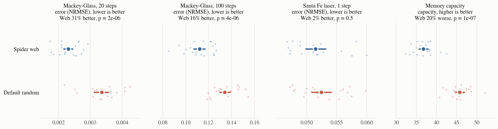
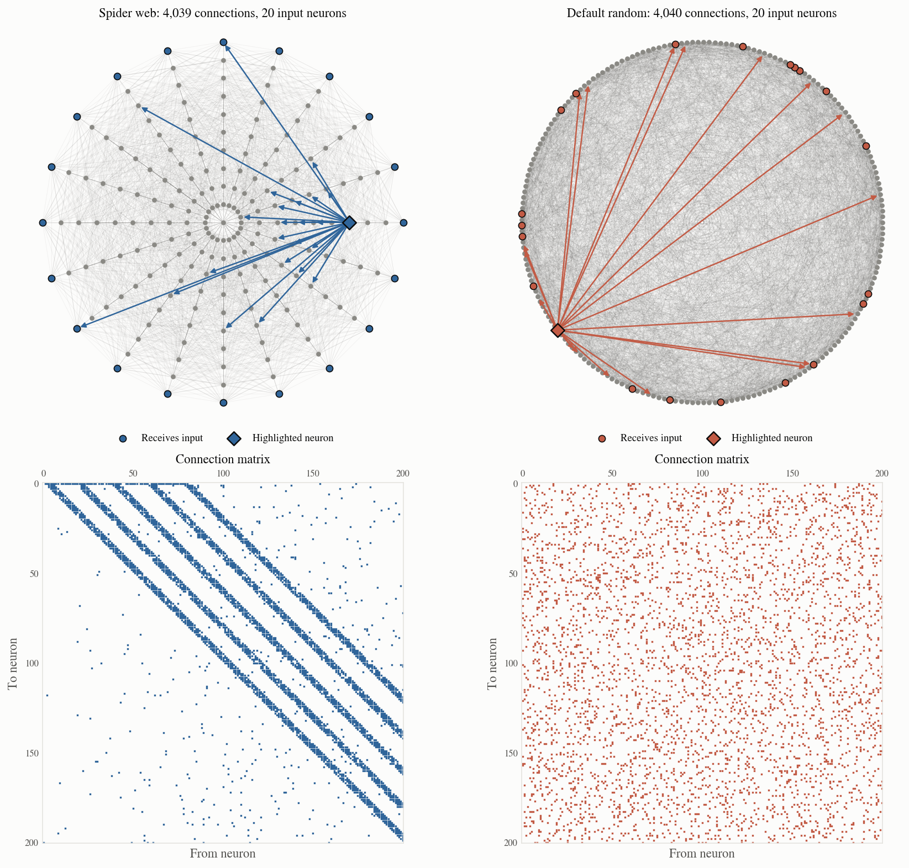
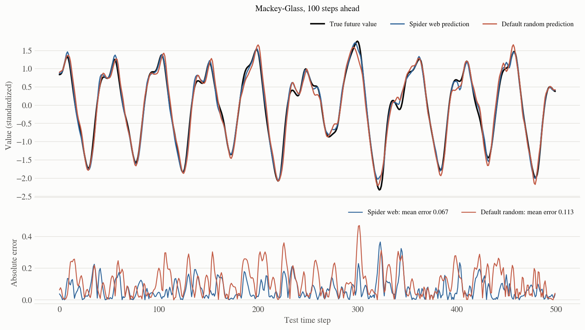
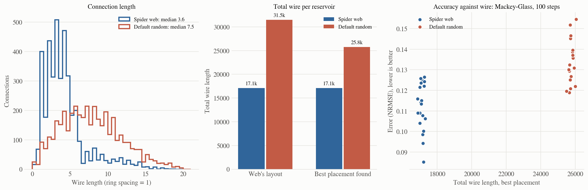

# Spider Web Reservoir

A reservoir computer wired like an orb spider's web, compared with
[ReservoirPy](https://github.com/reservoirpy/reservoirpy)'s default random reservoir on
forecasting accuracy and on the hypothetical cost of building it as a chip.

**Result:** with the same number of neurons, connections and input neurons, the web forecasts
the chaotic Mackey-Glass series **31% more accurately 20 steps ahead and 16% more accurately
100 steps ahead**, ties on the Santa Fe laser, and needs **about a third less wire**
even after the default's layout is optimized. The price is
**20% less short-term memory**.



## Background

A reservoir computer (or echo state network) feeds a signal into a fixed, randomly
connected recurrent network, the *reservoir*, and trains only a linear readout on the
network's states. The standard reservoir is a random sparse matrix. This project asks
whether *structure*, the geometry of a spider web, can do better than randomness while
keeping a reservoir's rich, chaotic dynamics.

## The design

201 neurons: a hub plus 10 rings × 20 spokes. Four rules define the web:

1. **Signals flow inward.** Every thread points from the rim towards the hub, the way
   vibrations from prey travel to a waiting spider. Each neuron feeds the next 5
   neurons inward along the spiral and the 5 nearest neurons on each of the next
   4 rings inward. That is 4,039 one-way threads, matching the default's 4,040 connections.
2. **One anchor thread closes the loop.** It runs from the hub back out to the rim. Without it
   the web has no cycles, so nothing echoes and the reservoir is dead.
3. **10% of threads are rewired at random.** This adds the long-range shortcuts that keep the
   dynamics rich (small-world rewiring, as in Watts and Strogatz).
4. **Input arrives only at the rim.** That is 20 neurons, the same number ReservoirPy's default feeds.

Weights are Gaussian and scaled to a chosen spectral radius, as in the default.
Every random draw (rewiring, weights, input signs) changes with the seed.



**Why it works:** the rim-to-hub flow is a staged pipeline. Each ring holds a slightly
older, more mixed version of the input, so the readout sees the recent past laid out in
layers, which is what chaotic forecasting needs. The default random reservoir mixes
everything with everything at once.

## How it was compared

| | |
|---|---|
| Reservoirs | `Spider web` (this design) and `Default random`: ReservoirPy 0.4.0's own `Reservoir` (10% connectivity, Gaussian weights, 10% of neurons get ±1 input) |
| Tasks | Mackey-Glass forecasts 20 and 100 steps ahead; Santa Fe laser, 1 step ahead; memory capacity (recall the input 1 to 300 steps ago) |
| Data | 4,000 training, 1,000 validation and 1,000 test steps; first 100 discarded as warm-up |
| Tuning | Each reservoir is tuned separately for each task on validation data, using 3 reservoirs: spectral radius (9 values, 0.5–3), leak rate (4), input scaling (3), ridge (4) |
| Testing | 20 *fresh* reservoirs of each kind (seeds 100–119) on the held-out test data |
| Score | Normalized RMSE for forecasts; memory capacity = summed r² over delays |
| Statistics | Bootstrap 95% intervals; two-sided Mann-Whitney U test |

## Results

| Task | Spider web | Default random | Web vs default | p |
|---|---|---|---|---|
| Mackey-Glass, 20 steps (error) | **0.0023** (0.0022–0.0024) | 0.0034 (0.0031–0.0036) | 31% better | 2e-06 |
| Mackey-Glass, 100 steps (error) | **0.1121** (0.1069–0.1168) | 0.1340 (0.1297–0.1387) | 16% better | 4e-06 |
| Santa Fe laser, 1 step (error) | 0.0514 (0.0498–0.0532) | 0.0524 (0.0508–0.0541) | 2% better (tie) | 0.5 |
| Memory capacity | 36.8 (35.7–37.9) | **45.8** (44.7–46.9) | 20% worse | 1e-07 |

Means of 20 test reservoirs, with 95% intervals in brackets. The three significant
differences remain significant after a Bonferroni correction for the four tests.

Here is a single test reservoir of each kind forecasting 100 steps ahead:



## Hypothetical hardware cost

Picture each reservoir as a chip. Neurons sit on the web's 201 sites (rings 1 unit
apart, inside a circular die of radius 10.5), every connection is a straight wire, and
every input neuron needs a wire from the die's edge. Wire length is a standard proxy for area, delay and
energy in physical and neuromorphic hardware. To be fair to the default, both
reservoirs were also given the **best placement found**: 200,000 greedy swaps of
neurons between sites to shorten the wiring.

| Hardware (mean of 20) | Spider web | Default random | Web / default |
|---|---|---|---|
| Operations per time step | 4,261 | 4,262 | 1.00 |
| Total wire, web's layout | 17,111 | 31,508 | 0.54 |
| Total wire, best placement | **17,106** | 25,756 | **0.66** |
| Input wire | 10 | 102 | 0.10 |

- **Compute is identical.** Both need about 4,260 multiply-adds per step, so the web's
  accuracy comes at no extra cost.
- **The web needs 34% less wire** even against the default's best placement. Its wires are
  short (median 3.6 vs 7.5), and the optimizer could barely improve its natural layout,
  which is already close to optimal. The default's random connections have no locality for
  any layout to exploit.
- **Input wiring is nearly free.** Rim input neurons sit at the die's edge.



## The trade-off: memory

The web recalls the last ~20 inputs as well as the default but forgets sooner, ending with
20% less memory capacity (36.8 vs 45.8). Signals flow inward and drain into the hub instead
of circulating. For forecasting, recent history matters most, so the trade pays off. For tasks
that need long memory, the default is the better choice.

## What didn't work (from the exploration that led here)

- **A two-way web** (symmetric threads) and a **sparse web** (400 threads) both trailed the
  default. Inward flow and enough connections were both needed.
- **No rewiring** forecasts worse; **full rewiring** turns the web back into a random reservoir.
  About 1–10% rewiring works best.
- **Input at random neurons or on every ring** removes most of the advantage. Input at the
  rim, flowing inward, is part of what makes the structure useful.
- **Imperfections** (broken threads, torn holes) cost little accuracy and save ~22% of
  connections, but did not improve it.
- **A strong spiral** (a delay line through every neuron) raised memory as far as 74, but
  only by giving up the forecasting edge.

## Limitations

- One network size (201 neurons) and three forecasting tasks.
- The hardware model is hypothetical: wire length is a proxy, not a measured energy figure.
- Hyperparameters were tuned on a coarse grid. A finer search could move both reservoirs a little.

## Run it

```bash
python -m venv .venv && .venv/bin/pip install -r requirements.txt
.venv/bin/python experiment.py   # tune, test and cost both reservoirs, writes results/results.json
.venv/bin/python figures.py      # draws figures/ and writes results/summary.md
```

`experiment.py` takes about 2.5 minutes on 16 cores. Every random draw is seeded, so reruns
on the same package versions should reproduce the numbers above.

| File | Contents |
|---|---|
| `topology.py` | The web's rules, the default reservoir, and the shared layout |
| `tasks.py` | Benchmark data and splits |
| `hardware.py` | Operation counts, wire lengths and the placement optimizer |
| `experiment.py` | Tuning, testing and costing |
| `figures.py` | All figures and the summary table |
| `results/` | `results.json` (every score, setting and cost) and `summary.md` |
| `figures/` | The four figures above |
